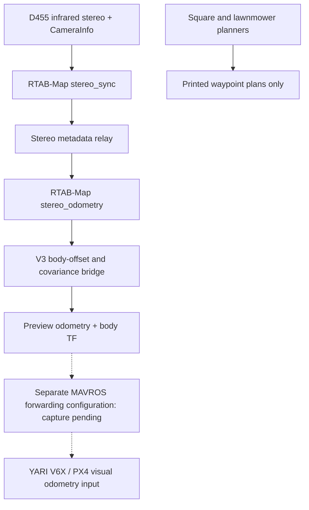

# NIDAR AirMouse

Indoor drone research on Raspberry Pi 5, Ubuntu 24.04 and ROS 2 Jazzy, using Intel RealSense D455 stereo odometry and a YARI V6X flight controller running PX4 with MAVROS.

**Development and bench integration only. Autonomous flight has not been validated.** External-vision fusion remains disabled (`EKF2_EV_CTRL=0`); PX4 horizontal position and velocity estimates are not valid for autonomous flight. This repository does not provision firmware or change PX4 parameters.

## Current status

Project-owner verified progress: D455 stereo VIO is operational; ROS odometry reaches the V3 bridge; MAVROS forwards visual odometry to PX4 and PX4 receives `vehicle_visual_odometry`. Camera-to-body TF geometry was checked. Square and lawnmower planners run on the Pi. These historical hardware observations were supplied by the project owner and were not repeated during repository preparation.

The preferred pipeline starts around 9–10 Hz and may slow to 4–5 Hz as its local feature map fills. Bundle adjustment accounts for approximately 40.7% of measured estimation time. These are recorded observations, not guaranteed performance.

The V3 script publishes `/nidar/vehicle_odometry_preview_v2` and TF only. The separately tested MAVROS forwarding setup is not captured as a reproducible launcher here. YDLIDAR X2 integration is planned; no project-specific driver configuration or test evidence was found.

## Architecture



## Layout

- `script/`: preferred launcher, relay, V3 bridge, planners and existing diagnostics.
- `config/`: historical parameter snapshot; preferred settings live in the launcher.
- `docs/`: hardware, setup, VIO, integration, missions, LiDAR and repository scope.
- `tests/`: offline planner checks.
- `ros2_ws/src/open_vins/`: previously committed legacy research source; not required by the preferred pipeline. Its upstream license is retained; no project-wide license has been approved.

## Setup and use

See [setup](docs/setup.md) for dependencies and version capture. Keep runtime copies at `$HOME/NIDAR AirMouse` because existing scripts use that path. Do not copy this review checkout over a running installation.

For a fresh bench session with no existing camera/VIO pipeline:

```bash
cd "$HOME/NIDAR AirMouse"
bash script/start_nidar_vio_ba5_map1200.sh
```

In a separate sourced terminal, after checking there is no competing body TF publisher:

```bash
source /opt/ros/jazzy/setup.bash
cd "$HOME/NIDAR AirMouse"
python3 script/nidar_bridge_v3.py
```

The launcher starts camera, synchronizer, relay and odometry, and writes logs under `logs/vio/`. Ctrl+C stops its managed pipeline. Do not run it alongside the working pipeline. The bridge does not start MAVROS or forward to PX4 automatically.

Planning requires only Python 3:

```bash
python3 script/nidar_square_mission.py 0.5
python3 script/nidar_lawnmower_mission.py 0.5
python3 -m unittest discover -s tests
```

Height is a finite positive number in metres. Both print fixed 1 m × 1 m routes; neither arms, takes off, lands or sends flight commands.

## Documentation

[Architecture](docs/architecture.md) · [Hardware](docs/hardware.md) · [Setup](docs/setup.md) · [VIO](docs/vio.md) · [MAVROS/PX4](docs/mavros_px4.md) · [Missions](docs/missions.md) · [LiDAR](docs/lidar.md) · [Repository scope](docs/repository_scope.md)

## Limitations and roadmap

Capture the tested MAVROS serial/plugin/remapping configuration without private connection details; export reviewed calibration references; validate timing, covariance and frame assumptions; improve sustained odometry throughput; integrate and test LiDAR; evaluate estimator validity and simulation before designing any flight controller. The present planners are not autonomous flight controllers. No flight readiness is claimed.
