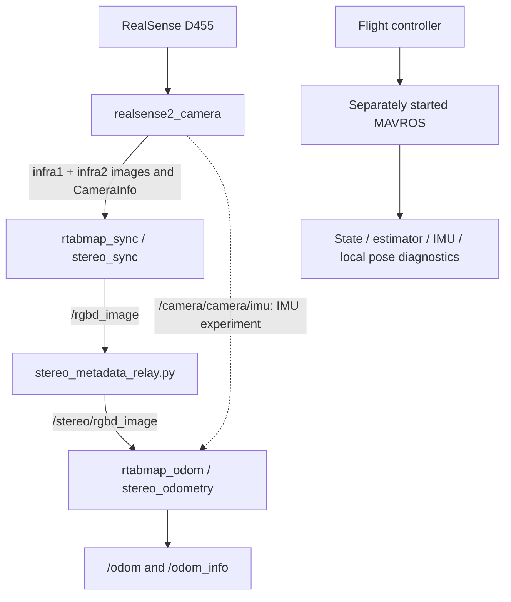

# NIDAR AirMouse

ROS 2 stereo odometry and flight controller diagnostics for the NIDAR AirMouse project. The repository combines an Intel RealSense stereo camera pipeline, RTAB-Map odometry, MAVROS monitoring, and a vendored OpenVINS research workspace.

The current launch baseline produces camera-relative odometry for bench testing. The repository preserves several VIO experiments so their settings can be compared without losing earlier configurations. Existing local diagnostic reports show stereo odometry messages and `OdomInfo.lost: False` during a previous inspection; this is historical bench evidence, not validation of every launcher or flight readiness. No hardware validation was performed as part of repository preparation.

## Hardware and software

| Component | Repository evidence and role |
| --- | --- |
| Intel RealSense D455 | Identified in local camera logs; supplies left/right infrared images, calibration, accelerometer and gyroscope streams. |
| ARM64 Raspberry Pi platform | Local diagnostics identify an Ubuntu 24.04 LTS `aarch64` system with a Raspberry Pi kernel; exact board model is not recorded. |
| YARI FMU v6X.x flight controller | Identified in USB diagnostics; monitored through an already running MAVROS connection. |
| ROS 2 Jazzy | Launchers source `/opt/ros/jazzy/setup.bash`. |
| RealSense ROS driver | Provides `realsense2_camera/rs_launch.py`; camera logs identify driver 4.58.4 and librealsense 2.58.4. |
| RTAB-Map ROS packages | `rtabmap_sync`, `rtabmap_odom`, and `rtabmap_msgs` provide synchronization, stereo odometry, and diagnostics. |
| OpenVINS 2.7.0 source | Vendored in `ros2_ws/src/open_vins`; separate estimator/research path, not launched by the NIDAR shell scripts. |

A USB connection with sufficient camera bandwidth and a separately configured MAVROS connection are required for the corresponding hardware workflows. Flight controller firmware and connection parameters are not provisioned here.

## ROS 2 architecture



The synchronizer approximately pairs the infrared images and calibration. Although the container is an `rtabmap_msgs/msg/RGBDImage`, its `depth` image carries the **right stereo image** in this pipeline. The relay changes only `depth_camera_info.header.frame_id` to `camera_infra2_optical_frame`, then republishes the message. It does not rectify images or recalculate calibration.

The baseline odometry uses `camera_link` as its reference and normally publishes in the `odom` frame. This is a temporary bench reference, not a calibrated vehicle body frame. The scripts do not bridge `/odom` into MAVROS vision input. Starting camera IMU streams does not establish tightly coupled inertial fusion; only the explicit IMU experiment connects that topic to odometry, and that connection alone does not prove full VIO fusion.

| Topic | Purpose |
| --- | --- |
| `/camera/camera/infra{1,2}/image_rect_raw` | Left and right rectified infrared images. |
| `/camera/camera/infra{1,2}/camera_info` | Intrinsics, projection matrices, and frame metadata. |
| `/camera/camera/accel/sample`, `/camera/camera/gyro/sample` | Separate camera inertial streams. |
| `/camera/camera/imu` | Unified camera IMU when enabled by the launcher. |
| `/rgbd_image`, `/stereo/rgbd_image` | Synchronized stereo container before and after metadata repair. |
| `/odom`, `/odom_info` | Estimated motion and RTAB-Map tracking quality/status. |
| `/mavros/state`, `/mavros/estimator_status` | Flight controller connection and estimator status. |
| `/mavros/imu/data`, `/mavros/local_position/pose` | Flight controller IMU and local pose observations. |

## Repository layout

```text
config/                      Saved RTAB-Map parameter snapshot
script/                      NIDAR launchers, experiments, relay, diagnostics
ros2_ws/src/open_vins/        OpenVINS source, configs, documentation and utilities
ros2_ws/frames_*.{gv,pdf}      Existing TF graph artifacts
```

`bags/`, `calibration/`, `docs/`, `launch/`, `scripts/`, and `src/` are currently empty placeholders at the project root; Git does not store empty directories. Runtime `logs/`, ROS build/install/log directories, bags, caches, local reports, credentials, and the old `diagnose_stereo_full.py.bak` are excluded. All remain on disk. Named launcher backups and recovery snapshots are intentionally versioned as experimental source.

## Setup and baseline usage

Most NIDAR scripts hard-code `$HOME/NIDAR AirMouse`. Keep this checkout at that location for their existing paths to resolve. Use Bash and quote the project path because it contains a space.

Install ROS 2 Jazzy and the RealSense, RTAB-Map, MAVROS, Python ROS message, `message_filters`, NumPy and OpenCV dependencies appropriate to the host. The active stereo pipeline uses installed ROS packages; it does not require building OpenVINS first. Confirm package availability:

```bash
source /opt/ros/jazzy/setup.bash
ros2 pkg prefix realsense2_camera
ros2 pkg prefix rtabmap_sync
ros2 pkg prefix rtabmap_odom
cd "$HOME/NIDAR AirMouse"
bash script/start_nidar_vio.sh
```

Run one complete pipeline launcher at a time to avoid duplicate camera and odometry nodes. The baseline waits for topics to be advertised, launches the relay and odometry, writes per-node logs under `logs/vio/`, and tails those logs. Topic discovery does not guarantee messages are flowing. Ctrl+C requests shutdown of the processes started by the launcher. Log filenames are reused and startup redirects can overwrite earlier runtime logs; archive any measurements you need before another run.

In a second sourced terminal:

```bash
cd "$HOME/NIDAR AirMouse"
source /opt/ros/jazzy/setup.bash
python3 script/check_stereo_sync.py
python3 script/diagnose_stereo_full.py
bash script/check_nidar_frequencies.sh
```

The frequency checker samples topics sequentially; it is not an instantaneous cross-topic measurement. Missing topics may reflect a stopped node or QoS mismatch. Diagnostics can take several minutes because of sequential timeouts.

### Working baseline and experimental launch configurations

All scripts below are invoked as `bash script/<filename>` from the project root, take no positional arguments, and retain their original behavior. The baseline and BA variants use approximate sync, QoS values `1` for images/calibration, and up to 1000 visual features where explicitly set. Settings omitted from a launcher come from the installed RTAB-Map version.

| Script | Purpose and configuration |
| --- | --- |
| `start_nidar_vio.sh` | Current baseline: full camera → sync → relay → stereo odometry startup, requested IR profile `640x480x30`, unified IMU method 2, image decimation 3, maximum 1000 features. IMU is published but not remapped into odometry. |
| `start_nidar_vio_backup.sh` | Preserved baseline copy with the same explicit pipeline settings as the current launcher. |
| `start_nidar_vio_ba5.sh` | Experiment: baseline plus `OdomF2M/BundleAdjustmentMaxFrames=5`, decimation 3. This sets the BA window limit; it does not explicitly select a BA backend. |
| `start_nidar_vio_ba5_dec2.sh` | Experiment: BA window 5, decimation 2 to retain more image detail. |
| `start_nidar_vio_ba5_kf110.sh` | Experiment: BA window 5, decimation 3, `Odom/VisKeyFrameThr=110`. |
| `start_nidar_vio_ba5_kf80.sh` | Experiment: BA window 5, decimation 3, `Odom/VisKeyFrameThr=80`. |
| `start_nidar_vio_ba5_dec2_imu.sh` | Experiment: BA window 5, decimation 2, remaps `imu` to `/camera/camera/imu`, sets `wait_imu_to_init=true`, `qos_imu=2`, `always_check_imu_tf=false`. Requires live unified IMU and suitable transforms; inertial accuracy is unverified. |
| `start_nidar_vio.sh.backup_20261022_142410` | Historical full launcher with driver-selected IR profile and default odometry decimation/features. |
| `start_nidar_vio.sh.backup_20261027_113707` | Historical full launcher with driver-selected IR profile, decimation 2 and 1000 features. |
| `start_nidar_vio.sh.recovery_20261022_142809` | Recovery full launcher with driver-selected IR profile, decimation 2 and 1000 features. |
| `nidar_master.sh` | Requires existing `/mavros`; reuses existing camera/sync/relay/odometry or starts missing components, then continuously samples topic rates and FC status. Writes `logs/master/`. See relay-path limitation below. |
| `nidar_vio.sh` | Requires an already running camera, reuses/starts sync, relay and odometry, then idles without continuous rate monitoring. Writes `logs/vio/`; no explicit decimation/feature overrides. See relay-path limitation below. |
| `nidar_fc.sh` | Repeated read-only `/mavros/state` and `/mavros/estimator_status` checks, with a 30-second pause between cycles. Requires existing MAVROS; logs to `logs/fc/checks.log`. |

**Preserved path limitation:** `nidar_master.sh` and `nidar_vio.sh` launch `$PROJECT/stereo_metadata_relay.py`, but the file in this checkout is `script/stereo_metadata_relay.py`. Their optional overlay path is `$PROJECT/install/setup.bash`, whereas the workspace overlay is `ros2_ws/install/setup.bash`. These wrappers can fail when starting a missing relay; source the actual workspace overlay manually when needed. Use `start_nidar_vio.sh` for the self-contained baseline. No scripts were patched during documentation preparation.

`config/odom_before_ba_test.yaml` is a complete saved `/stereo_odometry` parameter dump, including decimation 3, 1000 features, a BA frame limit of 10, and visual keyframe threshold 150. It is a historical comparison reference, not automatically loaded by the launchers. To deliberately use the snapshot, replace the normal odometry invocation in a manually managed pipeline with:

```bash
ros2 run rtabmap_odom stereo_odometry --ros-args \
  --params-file config/odom_before_ba_test.yaml \
  -r rgbd_image:=/stereo/rgbd_image
```

Do not run that extra odometry process alongside an existing one. Parameter availability depends on the installed RTAB-Map version.

### Every NIDAR support script

Shell commands use `bash script/<name>`; Python commands use `python3 script/<name>` after sourcing ROS. None accepts positional arguments.

| Script | Purpose, usage and output |
| --- | --- |
| `stereo_metadata_relay.py` | Run manually only when no relay is active. Republishes `/rgbd_image` on `/stereo/rgbd_image` with the right camera-info frame corrected. Runs until interrupted. |
| `check_stereo_sync.py` | Collects paired infrared images for 30 seconds using a 20 ms approximate-sync tolerance; reports signed median and maximum absolute timestamp skew over the retained samples (up to 300 pairs). |
| `check_nidar_frequencies.sh` | Sequential camera, depth, inertial, MAVROS, odometry and stereo-container rate checks; saves `nidar_frequency_report.txt`. |
| `diagnose_nidar.sh` | Read-only topic types/rates, odometry parameters/status, process/memory use and recent log warnings; prints to the terminal. Source ROS beforehand. |
| `diagnose_nidar_all.sh` | Broad ROS/system, calibration, image headers, raw/relayed containers, odometry and recent-log checks; writes timestamped `logs/vio/diagnostics_*.txt`. |
| `diagnose_stereo_full.py` | Live image intensity/texture, calibration, stereo-container, odometry quality and parameter checks; six-second message collection plus CLI checks; prints results. Requires NumPy and ROS/RTAB-Map messages. |
| `diagnose_stereo_pipeline.sh` | Topic endpoint/QoS checks, message definitions, sequential rates, odometry parameters, resource usage and warning summary; writes `logs/vio/stereo_pipeline_report_*.txt`. |
| `inspect_nidar.py` | System/topic/parameter/log inspection, saved stereo image ORB/SGBM analysis and live ROS checks. Saved images are expected at `logs/vio/stereo_check/{left,right}.png`; it does not capture them. Its depth estimate uses hard-coded approximate intrinsics/baseline. Prints results; source ROS first. |
| `nidar_full_check.sh` | System/USB/thermal checks, MAVROS connection and estimator observations, VIO topic rates and recent logs; writes `nidar_full_check_report.txt`. May attempt noninteractive `sudo -n fuser` to inspect the serial port holder. |
| `run_vio_diagnostics.sh` | Extended health report with CPU/thermal/storage, endpoint QoS, full node parameters, camera matrices, TF checks and rate samples; writes `logs/vio/full_diagnostics_*.txt`. |

The root `diagnose_stereo_full.py.bak` is a retained local historical diagnostic copy excluded as a backup; if needed it can be inspected or invoked with `python3 diagnose_stereo_full.py.bak` in a sourced ROS environment. Prefer the version under `script/`.

## OpenVINS workspace and bundled utilities

The vendored OpenVINS tree contains `ov_core` (features/cameras/inertial utilities), `ov_init` (initialization), `ov_msckf` (estimator and ROS visualization), and `ov_eval` (trajectory/timing evaluation). Its configuration directories provide estimator settings and Kalibr IMU/camera chains for EuRoC, KAIST, TUM VI, UZH FPV, RPNG rigs, D455 and T265. Dataset presets require matching sensors, topics and calibration; the bundled D455 preset is not proof of calibration for this physical rig.

To build this optional workspace with dependencies already installed:

```bash
source /opt/ros/jazzy/setup.bash
cd "$HOME/NIDAR AirMouse/ros2_ws"
rosdep install --from-paths src --ignore-src -r -y
colcon build --symlink-install
source install/setup.bash
ros2 launch ov_msckf subscribe.launch.py config:=rs_d455 rviz_enable:=true
```

The launch command is a separate experimental path. Inspect the chosen preset's topic names, extrinsics and timing before supplying live data. Dependency installation requires a configured rosdep database and suitable system packages; this documentation does not claim that the vendored source has been built on Jazzy.

All remaining bundled shell/Python utilities are listed below. Paths are relative to `ros2_ws/src/open_vins/`.

| Script | Purpose and usage |
| --- | --- |
| `ov_msckf/launch/subscribe.launch.py` | ROS 2 subscriber launcher. `ros2 launch ov_msckf subscribe.launch.py config:=rs_d455`; accepts `namespace`, `ov_enable`, `rviz_enable`, `config`, `config_path`, `verbosity`, `use_stereo`, `max_cameras`, and `save_total_state`. Defaults to EuRoC and two cameras. |
| `ov_msckf/scripts/run_ros_eth.sh` | Legacy ROS 1 batch EuRoC benchmark across mono/binocular/stereo modes. Run `bash ov_msckf/scripts/run_ros_eth.sh` after configuring dataset/output paths and a ROS 1 workspace. |
| `ov_msckf/scripts/run_ros_kaist.sh` | Legacy ROS 1 KAIST batch benchmark; same invocation pattern with its filename and required dataset/output configuration. |
| `ov_msckf/scripts/run_ros_tumvi.sh` | Legacy ROS 1 TUM VI batch benchmark; same invocation pattern with its filename and matching datasets. |
| `ov_msckf/scripts/run_ros_uzhfpv.sh` | Legacy ROS 1 UZH FPV batch benchmark; same invocation pattern with its filename and matching datasets. |
| `ov_msckf/scripts/run_sim_calib.sh` | Legacy ROS 1 Monte Carlo simulation comparing calibration and initial-state perturbation choices; `bash ov_msckf/scripts/run_sim_calib.sh` after configuring simulation trajectories/output locations. |
| `ov_msckf/scripts/run_sim_cams.sh` | Legacy ROS 1 Monte Carlo comparison of camera counts and cross-camera stereo tracking; invoke with Bash after configuring paths. |
| `ov_msckf/scripts/run_sim_featrep.sh` | Legacy ROS 1 Monte Carlo comparison of feature representations and scene depths; invoke with Bash after configuring paths. |
| `ov_eval/python/pid_ros.py` | ROS 1 per-node CPU/memory/thread logger: `rosrun ov_eval pid_ros.py _nodes:=/node1,/node2 _output:=/tmp/nidar_node_stats.txt`. Requires ROS 1 and psutil. |
| `ov_eval/python/pid_sys.py` | ROS 1/psutil process-name resource monitor: `python3 ov_eval/python/pid_sys.py <command-name>` in a ROS 1 environment; prints aggregate CPU/memory/thread use. |
| `run_format.sh` | From the OpenVINS root, `bash run_format.sh` runs clang-format in place on package C/C++ source. It modifies source files. |
| `run_copyright.sh` | From the OpenVINS root, `bash run_copyright.sh` rewrites source copyright headers using temporary files. It modifies source files; review before running. |
| `run_size.sh` | From the OpenVINS root, `bash run_size.sh` reports source counts using `cloc`; intended for an interactive terminal. |

The legacy batch scripts source a `devel/setup.bash` overlay and invoke `roslaunch`; they are not ROS 2 Jazzy launchers. They contain upstream machine-specific data/output paths and potentially lengthy benchmark loops. Benchmark data in `ov_data/` is excluded from this repository upload; obtain required trajectories/datasets separately. The local excluded `ov_data/kaist/matlab/` helpers convert KAIST ground truth (`kaist_convert_groundtruth.m`), calculate IMU-to-camera transforms (`kaist_calculate_imu2cam.m`), and convert rotation matrices to quaternions (`rot2quat.m`); use MATLAB with the associated KAIST data and configured paths.

Upstream Dockerfiles, ROS 1 `.launch` files, RViz layouts, CMake/package manifests, Doxygen sources and CI definitions are preserved. For implementation and research context, see the bundled [OpenVINS README](ros2_ws/src/open_vins/ReadMe.md) and [documentation source](ros2_ws/src/open_vins/docs/).

## Troubleshooting and limitations

- No images: check camera USB connectivity, `/camera/camera` discovery, image topics, and `logs/vio/camera.log`.
- Images but no stereo containers: inspect synchronizer topic remaps, calibration, timestamps and subscriber QoS with `diagnose_stereo_pipeline.sh`.
- Containers but lost tracking: inspect `/odom_info`, scene texture/exposure, image decimation, stereo calibration and CPU load. Compare experiments one at a time.
- IMU experiment stalls: check unified IMU publication and TF; camera IMU availability and estimator fusion are separate checks.
- Missing MAVROS: start the independently configured FC connection. The monitoring wrappers deliberately require it to exist already.
- Diagnostics may show no samples when subscriber QoS does not match a publisher. A discovered topic alone does not establish a healthy pipeline.

## Version control and licensing

The root `.gitignore` keeps generated data and credentials out of new commits while retaining code and calibration/configuration source. Ignore rules do not remove files already tracked in Git. Review `git status` and staged changes before publishing; do not place credentials in source or launch files.

OpenVINS retains its upstream copyright notices and [GPL v3 license](ros2_ws/src/open_vins/LICENSE). Other bundled notices remain in place. This repository does not add a separate license for original NIDAR scripts.
